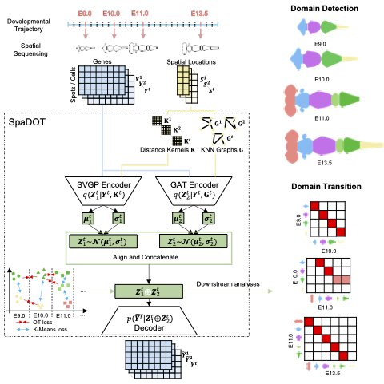

## SpaDOT Tutorial

**Authors:**<br>
[Wenjing Ma](https://marvinquiet.github.io/), Department of Biostatistics, University of Michigan<br>
[Siyu Hou](https://svvord.github.io/), Department of Biostatistics, University of Michigan<br>
[Lulu Shang](https://lulushang.org/), Department of Biostatistics, MD Anderson Cancer Center<br>
[Jiaying Lu](https://lujiaying.github.io/), Center for Data Science, School of Nursing, Emory University<br>
[Xiang Zhou](https://xiangzhou.github.io/), Department of Biostatistics, University of Michigan<br>

**Maintainer:** [Wenjing Ma](https://marvinquiet.github.io/) (wenjinma@umich.edu)<br>
**Latest revision:** November 12, 2026

# Contents

- [Introduction](#introduction)
- [Installation](#installation)
- [Example datasets](#example-datasets)
- [1. Load the data](#1-load-the-data)
- [2. Run SpaDOT preprocess](#2-run-spadot-preprocess)
- [3. Run SpaDOT train](#3-run-spadot-train)
- [4. Run SpaDOT analyze](#4-run-spadot-analyze)
- [5. Obtain the results](#5-obtain-the-results)

# Introduction

SpaDOT identifies spatial domains and infers their temporal associations in
spatiotemporal transcriptomics data. It combines a Gaussian-process encoder
with a graph-attention encoder to learn spatial representations across timepoints,
using clustering and optimal transport during training.

<p align="center">
  
</p>

The examples cover Chicken Heart and Mouse Embryo measured with 10x Visium,
and Axolotl Telencephalon measured with Stereo-seq. Each follows the same workflow:
load raw data, preprocess, train, analyze, and inspect the results.

# Installation

This page describes the current GitHub source, including the `epoch_stop`
configuration name and explicit feature-count requirement. To use it:

```shell
git clone https://github.com/marvinquiet/SpaDOT.git
cd SpaDOT
python -m pip install -e .
```

Use a separate Python environment (Python 3.9 was used for the examples).
Install the PyTorch Geometric sampling dependencies appropriate for your
PyTorch and CUDA versions; see the
[PyTorch Geometric installation guide](https://pytorch-geometric.readthedocs.io/en/latest/install/installation.html).
Check `torch.__version__` and `torch.version.cuda` before choosing wheels.
R and `libot.so` are not required.

The published package can also be installed with `python -m pip install SpaDOT`,
but a published release may precede the current source changes.

For command-line help:

```shell
SpaDOT -h
SpaDOT preprocess -h
SpaDOT train -h
SpaDOT analyze -h
```

# Example datasets

Run the following commands from the repository's `examples/` directory.
The raw H5AD files are available as [release assets](https://github.com/marvinquiet/SpaDOT/releases/tag/example-data-20261112).
Each notebook starts with a download cell that saves the corresponding file to
the path below and verifies its SHA-256. Matching local files are reused.

| Dataset | Raw file | Features per timepoint | Clusters per timepoint | Executed notebook |
|---|---|---|---|---|
| Chicken Heart | `ChickenHeart_data/ChickenHeart.h5ad` | 500,500,1000,1000 | 5,7,7,6 | [Chicken Heart](https://github.com/marvinquiet/SpaDOT/blob/main/examples/ChickenHeart.ipynb) |
| Mouse Embryo | `MouseEmbryo_data/MouseEmbryo.h5ad` | 3000,3000,3000 | 5,5,5 | [Mouse Embryo](https://github.com/marvinquiet/SpaDOT/blob/main/examples/MouseEmbryo.ipynb) |
| Axolotl Telencephalon | `AxolotlTelencephalon_data/Axolotl.h5ad` | 500,500,1000 | 6,7,8 | [Axolotl Telencephalon](https://github.com/marvinquiet/SpaDOT/blob/main/examples/AxolotlTelencephalon.ipynb) |

The notebooks contain their example-specific numeric selection settings and
cached spatial and transition plots. Use the notebooks to reproduce those
settings. The command-line example below uses the default selection settings
for the requested feature counts, which can select different genes.
See the [example workflow guide](example_workflow.md) for details.

Chicken Heart source data are available from
[GSE149457](https://www.ncbi.nlm.nih.gov/geo/query/acc.cgi?acc=GSE149457);
the [data assembly script](https://github.com/marvinquiet/SpaDOT/blob/main/analyses/process_ChickenHeart.py)
documents how the slices were combined.

# 1. Load the data

The input is an AnnData H5AD file containing raw counts in `adata.X`,
timepoint labels in `adata.obs["timepoint"]`, and finite two-dimensional spatial
coordinates in `adata.obsm["spatial"]`. Spot and gene names must be unique.
Keep spot order consistent when reproducing a run.

```python
import anndata as ad

adata = ad.read_h5ad("ChickenHeart_data/ChickenHeart.h5ad")
print(adata.shape)
print(adata.obs["timepoint"].value_counts(sort=False))
assert adata.obs_names.is_unique and adata.var_names.is_unique
assert adata.obsm["spatial"].shape == (adata.n_obs, 2)
```

# 2. Run SpaDOT preprocess

Provide one feature count per timepoint, in natural timepoint-label order.
Each count must be at least 100. SpaDOT validates the counts and selects
genes directly from the raw data using Python SPARK-X and pseudoregions.

```shell
SpaDOT preprocess \
  --data ChickenHeart_data/ChickenHeart.h5ad \
  --output_dir ChickenHeart_output \
  --n_features 500,500,1000,1000
```

This writes `ChickenHeart_output/preprocessed_ChickenHeart.h5ad`,
per-timepoint gene lists, the union gene list, and `SVG_selection.json`.
Selected counts are normalized, log-transformed, and scaled separately
within each timepoint.

To preprocess all genes instead, omit `--n_features` and use
`--no-feature-selection`:

```shell
SpaDOT preprocess \
  --data ChickenHeart_data/ChickenHeart.h5ad \
  --output_dir ChickenHeart_all_genes_output \
  --no-feature-selection
```

# . Run SpaDOT train

```shell
SpaDOT train \
  --data ChickenHeart_output/preprocessed_ChickenHeart.h5ad \
  --output_dir ChickenHeart_output \
  --device cuda:0 \
  --save_model
```

The bundled configuration starts at epoch 1 and trains while `epoch < 100`:

```yaml
epoch_start: 1
epoch_stop: 100
kl_cycle_epochs: 30
```

The KL cycle period is independent of the stopping bound. The saved model
and latent representation come from the final executed epoch.
To change settings, copy the
[configuration file](https://github.com/marvinquiet/SpaDOT/blob/main/SpaDOT/config.yaml)
and pass `--config path/to/config.yaml`.
Use `--device cpu` if a GPU is unavailable; runtime depends on the data and hardware.

For the deterministic setup used by the examples, follow the environment and
thread settings in the notebooks and use the same software versions, input
ordering, and random seed.

# 4. Run SpaDOT analyze

Supply one domain count per timepoint:

```shell
SpaDOT analyze \
  --data ChickenHeart_output/latent.h5ad \
  --output_dir ChickenHeart_output \
  --n_clusters 5,7,7,6 \
  --seed 2026 \
  --n_init 10
```

SpaDOT clusters each timepoint, computes spot-level transport between adjacent
timepoints, and aggregates it into domain transition tables. Final OT analysis
uses `epsilon=0.01`, `lambda1=1`, `lambda2=50`, and three growth updates.

The dot plots show the minimum of row- and column-normalized transition
probabilities. Values below 0.20 are grey; the saved transition tables retain
the original aggregated values. These associations do not establish cell lineage.

If domain counts are unknown, omit `--n_clusters` to use the WSS-based
adaptive clustering heuristic, which tests 4 through 20 clusters:

```shell
SpaDOT analyze \
  --data ChickenHeart_output/latent.h5ad \
  --output_dir ChickenHeart_adaptive_output \
  --prefix adaptive_ \
  --seed 2026 \
  --n_init 10
```

Adaptive counts are exploratory and need biological assessment. They need not
match the fixed-count example results.

# 5. Obtain the results

| Output | Contents |
|---|---|
| `preprocessed_ChickenHeart.h5ad` | Model input with selected features and stored counts |
| `SVG_genes.txt` and `SVG_genes_<timepoint>.txt` | Union and per-timepoint gene lists |
| `SVG_selection.json` | Selection settings and diagnostics |
| `latent.h5ad` | Learned embeddings, timepoint labels, and spatial coordinates |
| `loss.csv` | Training losses |
| `SpaDOT_model.pth` | Model weights, when `--save_model` is supplied |
| `<timepoint>_domains.png` | Spatial domain plots |
| `OT/` | Spot-level transport maps |
| `transition_table_<source>_<target>.h5ad` | Aggregated domain transition tables |
| `transition_dotplot_<source>_<target>.png` | Conditional-probability dot plots |

Transition filenames use ordered timepoint indices. Adaptive outputs also
include WSS plots and use the requested prefix. Use a new output directory
for a new run to preserve earlier results.

The three linked notebooks show the spatial panels and transition plots
inline. For questions or issues, use the
[GitHub issue tracker](https://github.com/marvinquiet/SpaDOT/issues).
